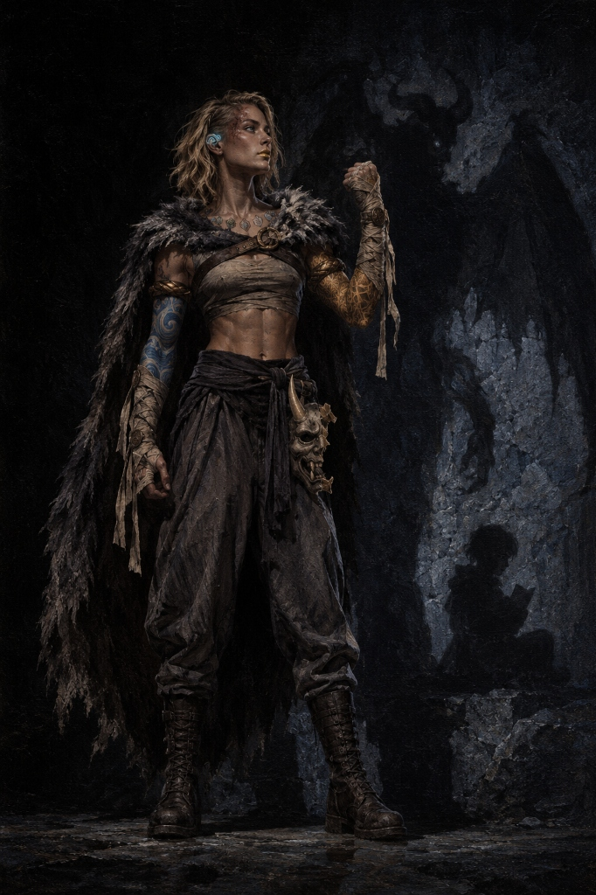
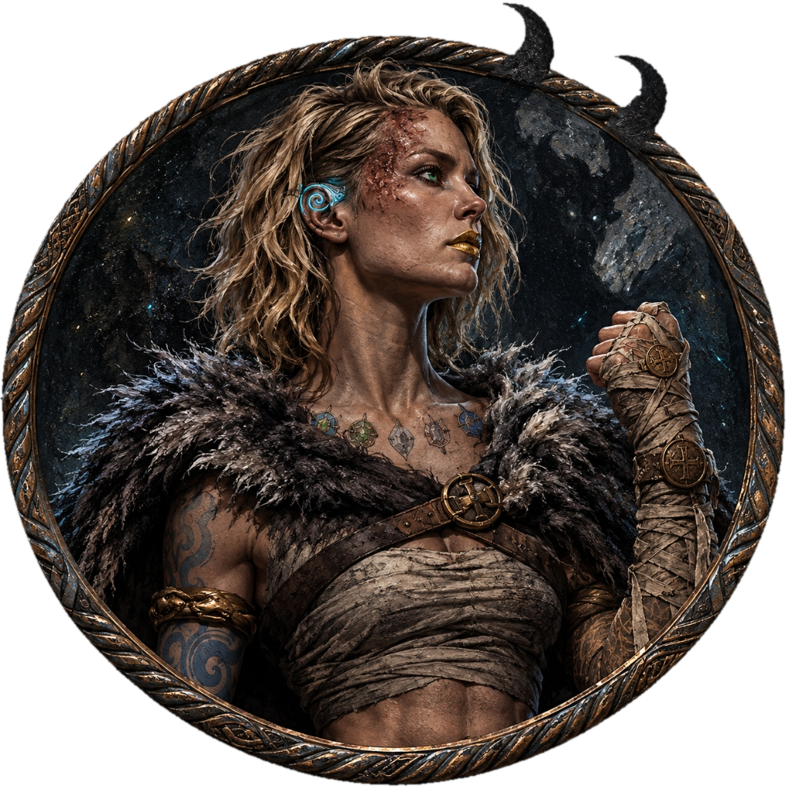

## Jäger (Loona)

### Full Body Image

### VTT Token

### Associated Files
- [Art Prompts & Tokens](Prompts.md)

---

## Character Overview

- **Character Name:** Jäger
- **True Name:** Loona (kept deeply hidden)
- **Class & Level:** Monk 17 (Way of Shadow) / Barbarian 3 (Path of the Beast) — Level 20
- **Heritage / Race:** Variant Human (German nationality aesthetic)
- **Background:** Criminal / Spy (Schatten Monastery Infiltrator)
- **Alignment:** Lawful Neutral
- **Age:** 26
- **Height:** 1.70 m
- **Weight:** 65 kg (dense athletic martial muscle)
- **Affiliation:** Formerly Schatten Monastery (Continent of Svarvok)

---

## The Triad of Personalities

Jäger's consciousness is divided into three distinct, interconnected personas born from childhood trauma, demonic sacrifice, and monastic survival. Following a transformative 6-month solitary reclusion, these fragments are no longer in volatile conflict, but aligned and unified under disciplined control:

1. **Jäger (The Shield & Guardian):**
   - The adult warrior persona manifested as an unyielding psychological and physical shield.
   - Disciplined, stoic, methodical, and battle-hardened.
   - Speaks with quiet authority and carries the monastic martial arts and survival knowledge.

2. **Loona (The Inner Child & Origin):**
   - The original child consciousness, deeply traumatized after nearly being sacrificed to a demon by her own parents before being saved by Schatten monks.
   - Gentle, observant, quiet, possessing an instinctive love for animals and books.
   - Represented in her cast shadow as a curled child seated with a book clutched to her chest.

3. **Sombra (The Shadow Beast & Protector):**
   - The monstrous, feral shadow entity born to violently protect Jäger and Loona from annihilation.
   - Embodies her Path of the Beast rage and Way of Shadow supernatural arts.
   - Casts a towering shadow of a horned, winged fiendish beast with tearing claws across walls and floors.

---

## 6-Month Time Jump & Evolution

Following severe demon-rage episodes during the campaign, Jäger entered a 6-month self-imposed exile to heal and reconcile her fragmented psyche before the final campaign battle:

- **Psychological Reckoning:** Worked with a wilderness shaman and meditative introspection to process the monastery's abandonment and reconcile Jäger, Loona, and Sombra into a cooperative unit.
- **Physical Conditioning:** Pushed her physical limits through extreme wilderness survival and beast training, growing significantly more muscular, resilient, and grounded.
- **Severing Monastic Dogma ("Sem Máscara"):** Cast aside the Schatten code of absolute faceless anonymity. Rather than carving new masks to hide behind, she unmasked her face completely, keeping only her last hand-carved demon mask—shattered in half—as a reminder of the past tied to her hip.
- **Grounding Rituals:** Practiced cooking, quiet survival craft, and peaceful communication to cultivate inner stillness amidst rage.
- **Memorial Tattoos:** Inked eight stylized gemstone illustrations across her collarbone to honor fallen comrades and beloved companions.

---

## Physical Appearance

- **Physique:** Muscular, lean, and athletic female frame (1.70m, 65kg) with defined abdominal muscles, vascular arms, and powerful legs. Her chest is small, athletic, and firmly bound in utilitarian monastic linen wraps (combat-functional, non-sexualized).
- **Face & Expression:** Striking Northern European / German facial features with high cheekbones, refined jawline, and straight nose, radiating profound *war serenity*—a calm, tranquil, and battle-hardened dignity.
- **Hair:** A chic, side-parted chin-to-shoulder-length tousled blonde bob with natural waves and textured loose layers that frame her face gracefully.
- **Scars:** A distinct singed burn scar across one side of her face where the outer half of one eyebrow is completely burned away and hairless, with healed singed texture trailing toward the temple, contrasting with the intact inner brow.
- **Lips:** Always adorned with bold, immaculate metallic golden lipstick.
- **Jewelry:**
  - **Earring of Whisper / Solar Charisma:** Clamped along the cartilage of her right ear is a sculpted hammered-silver ear cuff with glowing cyan-blue inlaid grooves forming an elegant mystical spiral swirl.
  - **Viking Bicep Rings:** A single forged torc arm ring of twisted dark iron and weathered bronze with beast-finial ends worn high around each bicep.
- **Tattoos & Inks:**
  - **Left Arm:** Full continuous sleeve of intricate golden geometric bands and arcane monastic runes from knuckles to shoulder.
  - **Right Arm:** Full continuous sleeve of flowing light-blue and cyan cloudy wind-bars and monastic irezumi waves from knuckles to shoulder.
  - **Back:** Faint yellow feathered angel/falcon wings tattooed across her shoulder blades.
  - **Collarbone Memorial Inks:** A horizontal constellation of eight stylized 2D inked gemstone tattoos across her upper chest:
    - *Grog*
    - *Nesh*
    - *Singolas*
    - *Strudul* (illustrated with subtle animal ears)
    - *Gwil* (cracked gemstone on the left)
    - *Brethan* (cracked gemstone on the right)
    - *Arien*
    - *Tristan*
- **Attire:**
  - **Blaidd's Cloak:** Heavy, shaggy grey-and-black wolf-fur pelt with a thick beast collar and ragged tattered hem, firmly anchored across her chest with a crossed dark-leather harness and antique bronze ring-brooch.
  - **Torso & Legs:** Dark monastic linen bandages bound across the chest, bare midriff, and dark charcoal pleated martial arts trousers.
  - **Magical Fist Wraps (Wraps of the Restless):** Layered sand-tan silk/linen ribbon wraps coiling around her palms, wrists, and forearms with dynamic trailing ribbon ties, anchored by circular antique bronze medallion coin-clasps.
  - **Footwear:** Heavy-duty, calf-high dark leather combat boots with solid reinforced closed-toe caps completely covering and encasing both feet.
  - **Hip Trophy:** A hand-carved dark wood and bone demon mask scaled 1:1 to her face, shattered in half with jagged fracture edges, tied to her hip sash.

---

## Combat & Mechanics (D&D 5e)

### Core Statistics
- **Armor Class (AC):** 21 (Unarmored Defense + items)
- **Hit Points:** 163 (16d8 + 3d12)
- **Speed:** 65 ft. (Walking)
- **Senses:** Blindsight 60 ft., Darkvision
- **Initiative:** +5
- **Proficiency Bonus:** +6

### Ability Scores
| Ability | Score | Modifier | Saving Throw |
| :--- | :---: | :---: | :---: |
| **Strength (STR)** | 11 | +0 | +6 (Adv. in Rage / DEX checks) |
| **Dexterity (DEX)** | 20 | +5 | +11 |
| **Constitution (CON)** | 16 | +3 | +9 |
| **Intelligence (INT)** | 12 | +1 | +7 |
| **Wisdom (WIS)** | 18 | +4 | +10 |
| **Charisma (CHA)** | 19 | +4 | +10 |

### Skills
- **Stealth:** +17 (Expertise)
- **Acrobatics:** +11
- **Insight:** +10
- **Perception:** +10
- **Animal Handling:** +10
- **Deception:** +10

### Key Features
- **Way of Shadow Arts:** Cast *Darkness*, *Darkvision*, *Pass without Trace*, *Silence*, or *Minor Illusion* using Ki.
- **Shadow Step:** At will, teleport up to 60 ft. from one shadow/dim light into another as a bonus action, gaining advantage on the next melee attack.
- **Cloak of Shadows:** In dim light or darkness, become invisible as an action.
- **Form of the Beast (Rage 3/day):** Manifest beast weapons (bite, claws, or reaction tail parry) during rage.
- **Peace in Fury (Homebrew Mastery):** Add Wisdom modifier to rage damage instead of the standard rage table; maintains mental concentration and shadow arts even while raging.
- **Purity of Body & Diamond Soul:** Immune to poison and disease; proficient in all saving throws.

---

## Equipment & Vault

- **Equipped / Attuned:**
  - *Bandagem de Mãos +1* (Intricate sand-tan Wraps of the Restless)
  - *Ear cuff of Solar Charisma / Earring of Whisper*
  - *Barrier Tattoo*
  - *Amulet of Proof against Detection and Location*
  - *Capa Resistência Calor / Blaidd's Wolf Cloak*
  - *Raven's Slumber*
  - *Blindfold of True Darkness*
  - *Robe of Useful Items*
- **Weapons & Tools:**
  - Monk Quarterstaff
  - Concealed Daggers
  - +1 Blowgun & Needles
  - Rope Dart (15/30)
  - Thieves' Tools, Woodcarver's Tools (used to carve masks)
