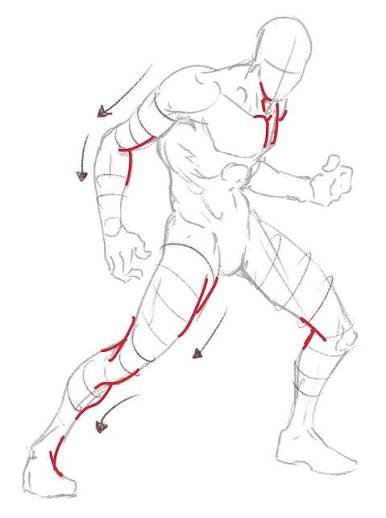
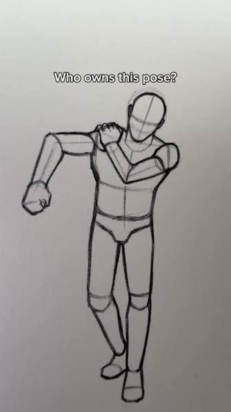
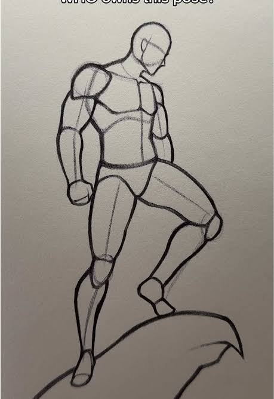
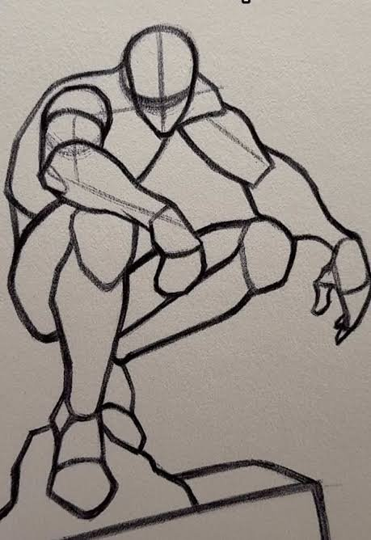

---
aliases:
  - Characters Stances
  - Character Stance
  - Stance References
  - Poses
tags:
  - reference
  - stances
  - characters
  - anatomy
---

# Character Stances

Visual reference catalog for character poses, anatomical line of action, and combat/exploratory stances. These references serve as guides for character sketches, token framing, and image generation prompts.

---

## 1. Predatory Combat Stance

- **Pose Dynamics:** Low athletic prowl, aggressive forward torso hunch at the waist, and a wide, stable combat base.
- **Limb Positioning:** Lead leg forward with knee bent and foot firmly planted; trailing leg extended diagonally back in a braced, grounded line.
- **Arms & Hands:** Forward lead arm bent sharply at the elbow with a clenched fist held close to mid-chest ready to strike; trailing arm angled back along the flank with fingers curled in a tense, predatory claw.
- **Anatomy & Flow:** Strong dynamic tension with forward-leaning center of gravity, hunched neck thrust forward, and eyes locked ahead.
- **Ideal Archetypes:** Monks, beast-barbarians, martial artists, predatory stalkers, feral brawlers (e.g. Jaeger).

---

## 2. Walking Shoulder-Touch Stance

- **Pose Dynamics:** Controlled forward stride, natural body weight shifting over the lead leg in mid-walk.
- **Limb Positioning:** One hand casually raised to rest against the opposite shoulder or back of the neck, while the other arm swings naturally at the side with a loose, relaxed hand.
- **Attitude & Mood:** Confident, nonchalant, relaxed swagger, conveying calm assurance or casual defiance.
- **Ideal Archetypes:** Rogues, duelists, gunslingers, swashbucklers, anti-heroes.

---

## 3. Heroic Rock-Perch Stance

- **Pose Dynamics:** Upright, commanding posture atop an elevated vantage point, rocky outcrop, or cliff edge.
- **Limb Positioning:** One leg planted firmly on lower ground, the other leg bent and elevated onto the rock; torso turned slightly at three-quarters with head tilted down in a stern, surveying gaze.
- **Attitude & Mood:** Stoic, triumphant, commanding presence overlooking a battlefield or horizon.
- **Ideal Archetypes:** Paladins, rangers, scouts, commanders, heroic leaders.

---

## 4. Gargoyle Perched-Crouch Stance

- **Pose Dynamics:** Deep, symmetrical low crouch perched upon a narrow ledge, gargoyle pedestal, or stone parapet.
- **Limb Positioning:** Knees drawn high toward chest and shoulders; arms hooked forward over knees or dangling loosely between them with fingers tensed and gripping the edge.
- **Attitude & Mood:** Coiled vigilance, predatory stillness, brooding watcher waiting in the shadows.
- **Ideal Archetypes:** Assassins, stealth rogues, shadow monks, vigilantes, fiendish/monstrous creatures.
